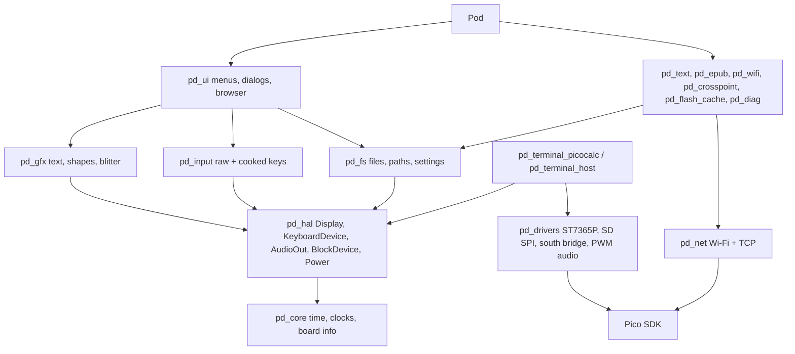

# Architecture

## Three axes

PicoPods separates three things that change independently:

| Axis | Examples | Where it lives | Selected by |
|---|---|---|---|
| **Board** — the programmable module | Pico, Pico W, Pico 2, Pico 2 W, RP2350 boards with PSRAM | `pd/board.h`, `lib/hardware/core/src/sys_rp2.cpp` | `-DPD_BOARD=` (Pico SDK board name) |
| **Terminal** — the device the board plugs into | PicoCalc, the PC (`host`) | `lib/hardware/terminals/<name>` | `-DPD_TERMINAL=` |
| **Pod** — your firmware | PodBoy, Pod Writer, Pod Files, PicoCraft | `pods/<name>` of a pod repository (helium-, carbo-, aurum-pods); examples: `examples/<name>` here | `picopods_add_pod()` |

Apps never name a pin, an SPI instance or a chip. They see the terminal through HAL interfaces and ask the board what it can do.

## Layers

Rules that keep the layers honest:

- Only `pd_drivers`, `pd_terminal_*`, `pd_core`, `pd_net` (CYW43 backend), `pd_fs` (FatFs backend), `pd_usb_drive` (TinyUSB backend), `pd_flash_cache` and `pd_diag` include Pico SDK headers. Everything else is plain C++17 and compiles on a PC.
- Libraries above the HAL take a HAL object or use the terminal passed in; they do not know which driver is behind it.
- Drivers take all pins and buses in a `Config` struct. A driver is reusable by any terminal that has the same chip.
- The terminal is the only place where pins are written down.

## The HAL

| Interface | Model | Notes |
|---|---|---|
| `hal::Display` | Window + stream: `begin(x0,y0,x1,y1)`, `write()`/`write_async()`, `end()` | Matches SPI panels. `format()` says RGB666/RGB565/RGB888; `encode()` converts `0xRRGGBB`. `fill()` has a generic implementation. |
| `hal::KeyboardDevice` | `read(RawKey&)`: code + pressed/held/released | Codes are the PicoCalc codes (`pd/keys.h`), the common set for all terminals. |
| `hal::AudioOut` | Ring of stereo int16 frames at a chosen rate | `buffered()` is the audio clock: games pace on it. |
| `hal::BlockDevice` | 512-byte sectors | FatFs is mounted on it through `lib/services/fs/src/diskio.cpp`. |
| `hal::Power` | Battery %, charging | |

## Keyboard: one stream, two layers

The PicoCalc keyboard controller is slow (each I2C read waits ~16 ms). `pd::input::Keyboard` reads the device either synchronously (throttled, what Pod Writer does) or on core 1 into a lock-free queue (`TerminalConfig::keyboard_on_core1`, what PodBoy does). On top of the same stream:

- `poll_raw()` returns every press and release and maintains `down(code)`: games map keys to buttons.
- `poll()` / `wait()` return presses with Ctrl/Shift/Alt attached and generate auto-repeat: menus and editors.

Both can be used in the same app (a game's play loop uses the raw layer, its pause menu the cooked one). `inject()` feeds events for tests and macros. Dialogs wait through `ui::Context::wait_key()`, which runs `Context::idle` meanwhile, so Wi-Fi polling or audio refills continue while a menu is open.

## Drawing without a framebuffer

The PicoCalc panel only accepts 18-bit colour, so a full framebuffer would take 300 KB. `pd_gfx` streams everything through one row buffer (960 bytes): text is rendered one pixel row at a time with colours converted once per character (Pod Writer's renderer). Apps that do want a framebuffer use `IndexedBlitter`: 8-bit indices + palette, converted and scaled only for the lines that changed, sent by DMA while the CPU keeps working (PodBoy's video path).

## Files

`pd_fs` has two backends behind one API: FatFs on the SD card for the device, POSIX files under a folder on the host. The editor engine, ePub writer, settings, flash cache and file browser only use this API, which is why they can be tested on a PC with ASan/UBSan.

## Threads and cores

PicoPods is single-threaded by default. Core 1 is used only if the app asks for it (`keyboard_on_core1`, or `sys::launch_core1()` for its own work). `launch_core1()` prepares core 1 for `flash_safe_execute`, so the flash cache can write flash while core 1 runs. The PicoCalc south-bridge driver serialises I2C with a mutex, so the battery can be read from core 0 while core 1 polls keys.

## Memory

Static RAM of the demo on a Pico 2 W is about 108 KB, most of it lwIP and the CYW43 driver; the template uses 23 KB. Large buffers are allocated when a feature starts (`IndexedBlitter::begin`, `gfx::init`) and are sized from the actual display. Fonts are in flash (about 22 KB of glyph data for the four sizes).

## Build model

All libraries are CMake `INTERFACE` targets compiled into each app, like the Pico SDK's own libraries. Compile definitions set on an app (pin overrides, `PICO_PANIC_FUNCTION`, lwIP options) therefore reach the library code too. `cmake/picopods_init.cmake` runs before `project()` (board, terminal, SDK import); `cmake/picopods.cmake` after it (SDK init, libraries, `picopods_add_pod`).
